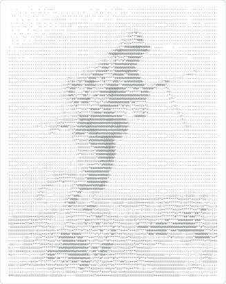

# UnitLocationData

An open, claim-based collection of historical military unit locations. A row says where a unit was, on a date, with coordinates, precision, confidence, sources, conflict handling and optional strength figures. Competing claims are kept, not averaged.

Each conflict lives in its own top-level folder, with its own schema, data, documentation, validation and build pipeline. The repository is set up to hold more than one conflict; only World War II is active so far.

## Active datasets

### World War II — [`WorldWar2/`](WorldWar2/)

**Version 1.1.0-rc1** (`schema_version` 1.1.0). The current build has **13,436 claims** (9,771 ground, 2,486 air, 1,179 naval) in **2,953 units** (105 of them placeholders). The surveyed focus is the Western Front, 6 June 1944 to 8 May 1945; a first Pacific increment covers the Guadalcanal campaign (664 claims). Claim dates in the files run from 16 September 1939 to 31 May 1945. Coverage is uneven and event-based, not a daily plot.

Start here:

- [`WorldWar2/README.md`](WorldWar2/README.md): what the dataset is, how to read a claim, files and keys, quick start, licence and citation
- [`WorldWar2/build/`](WorldWar2/build/): ready-to-use combined files (`all_claims.csv`, `claims.geojson`, `units.csv`, `command_relations.csv`, `places.csv`, `operations.csv`, `manifest.json`, and the rest)
- [`WorldWar2/data/`](WorldWar2/data/): the master data (one claim file per unit, the unit table, places, command relations, and the other source tables)
- [`WorldWar2/docs/`](WorldWar2/docs/): methodology, sources, roadmap, coverage, reuse and attribution
- [`WorldWar2/docs/theaters.md`](WorldWar2/docs/theaters.md): the two-level list of theaters and sub-theaters
- [`WorldWar2/docs/review/`](WorldWar2/docs/review/): review notes
- [`WorldWar2/CONTRIBUTING.md`](WorldWar2/CONTRIBUTING.md): how to fork, add a unit or a claim, run the checks, and start a new theater
- [`WorldWar2/docs/maintainers.md`](WorldWar2/docs/maintainers.md): how to run the checks and the public release rules
- [`WorldWar2/CITATION.cff`](WorldWar2/CITATION.cff): citation metadata
- [`WorldWar2/build/manifest.json`](WorldWar2/build/manifest.json): schema and data versions, checksums and row counts
- [`WebUI/`](WebUI/): a map viewer for this dataset

Run the scripts from inside `WorldWar2/` (for example `cd WorldWar2 && python scripts/validate.py`). The GitHub Actions workflow in `.github/workflows/` currently runs the validators against `WorldWar2/`.

## Further conflicts

Later conflicts will be added as their own top-level folders, on the same claim-based model, each with its own contributor guide and citation file.

## Licence

The whole repository — data, documentation, scripts and the web viewer — is licensed under CC BY-SA 4.0 (see [`LICENSE`](LICENSE)). Creative Commons recommends against using CC licences for software; Scott chose a single licence for the whole repository for simplicity (24 November 2026). Citation for the World War II dataset: [`WorldWar2/CITATION.cff`](WorldWar2/CITATION.cff).
